# 研程 · Research Rhythm

**把科研拆成今天能做完的事。**

研程是一个本地优先的科研日程、习惯打卡、课题推进与闪念记录 Web App。它把「今天做什么」和「课题走到哪一步」放在同一份数据里：日程可以关联到课题阶段，勾选完成后，阶段子事项和进度条同步前进。每天还会从你标记为提醒的「闪念」中随机抽一条，放在「今天」标题右侧。可选开启 GitHub Gist 同步，在电脑、手机和 iPad 之间自动同步。

<p align="center">
  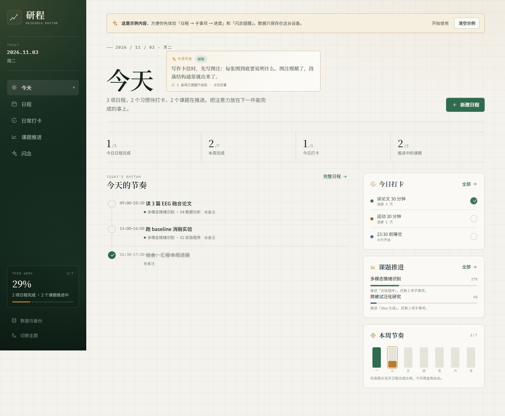
</p>

## 功能

| 模块 | 能做什么 |
|---|---|
| **今天** | 汇总今日日程、每日抽取的闪念、待打卡习惯、课题进度和本周节奏；点圆圈直接完成 |
| **日程** | 月 / 周 / 日三种视图；新建、编辑、删除、拖动改日期；完成后划线并填色 |
| **日常打卡** | 新建打卡、选择颜色、按天补记；完成的日期在月历中填色；连续天数统计 |
| **课题推进** | 新建课题自动生成 8 个阶段：Idea 生成 / 实验程序 / 数据收集 / 数据分析 / 结果讨论 / 论文写作 / 投稿 / 接收 |
| **阶段详情** | 每个阶段可设置起止日期、添加子事项、勾选完成；阶段与总进度按完成比例推进 |
| **双向联动** | 在日程中关联「课题 + 阶段」后自动生成子事项；完成日程会勾选子事项，完成子事项也会回写日程 |
| **闪念** | 记录经验、灵感、心情和随记；可标记「每日提醒」，每天从提醒池中随机抽一条显示在「今天」标题右侧 |
| **本地数据** | 数据保存在浏览器 localStorage；支持下载 / 复制 JSON 备份、文本或文件导入 |
| **跨设备同步** | 可选 GitHub Gist 同步：创建 / 连接 Gist，自动推送与拉取；冲突时选择保留本地或云端 |
| **PWA** | 可添加到手机主屏幕，离线打开；深色 / 浅色 / 跟随系统主题 |

「今日闪念」在同一天内保持同一条，刷新不会跳变；次日会重新抽取。每条闪念默认不提醒，只有在编辑时勾选「在『今天』提醒」才会进入抽取池。

### 界面

| 日程 | 课题推进 |
|---|---|
| 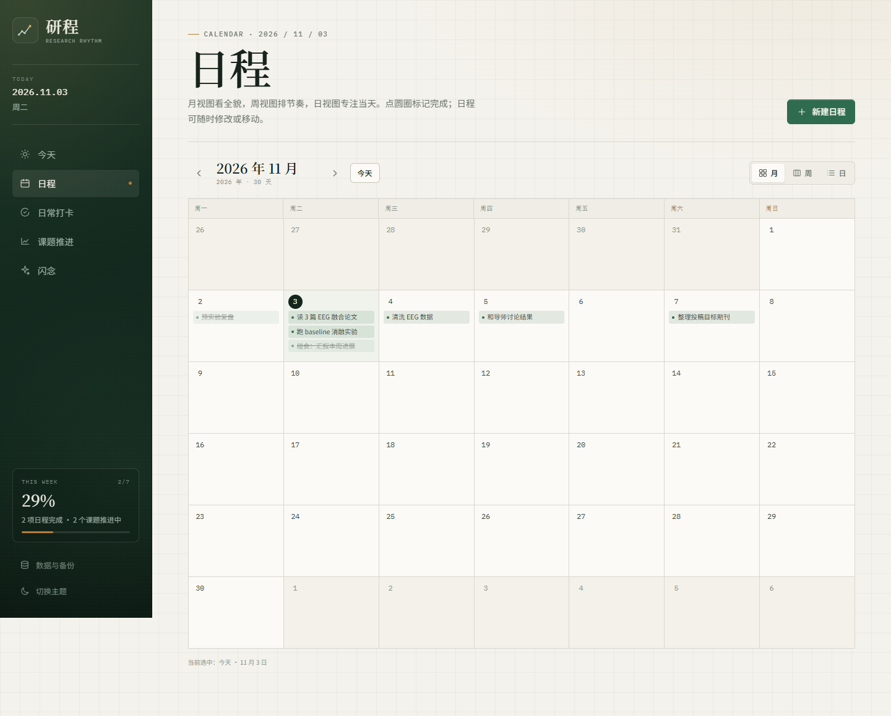 | 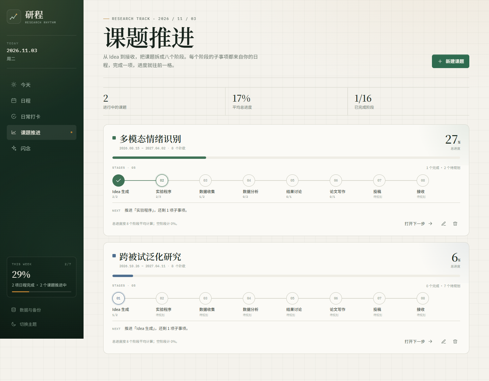 |

| 日常打卡 | 阶段详情 |
|---|---|
| 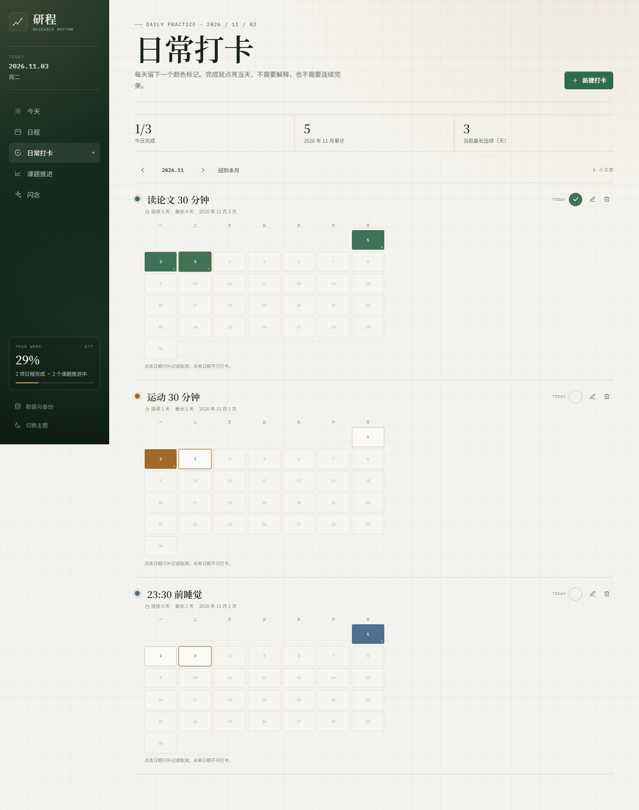 | 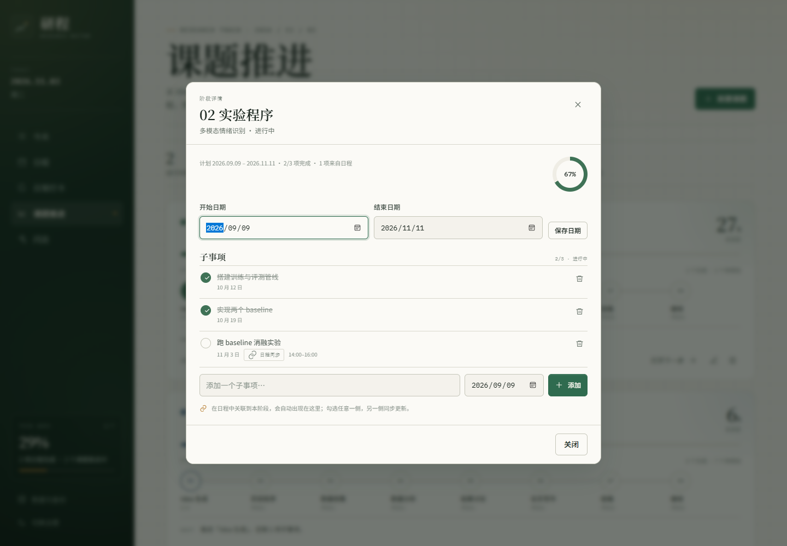 |

| 闪念 | 记录闪念 |
|---|---|
| 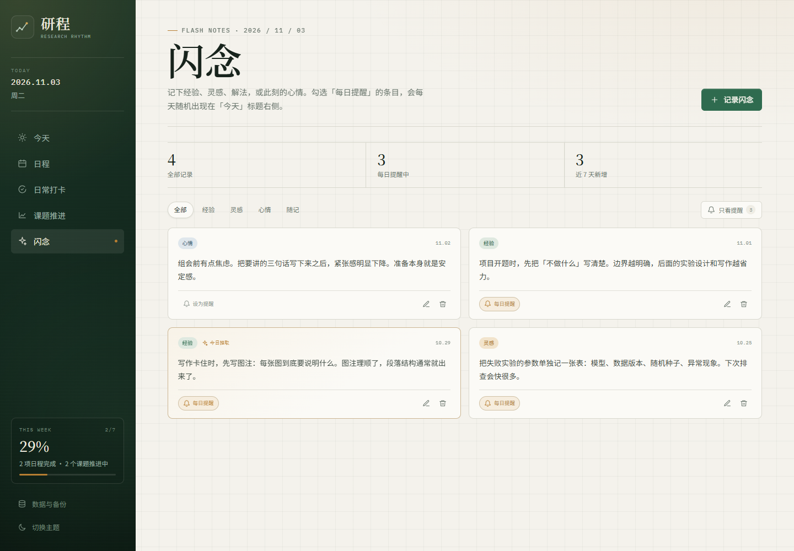 | 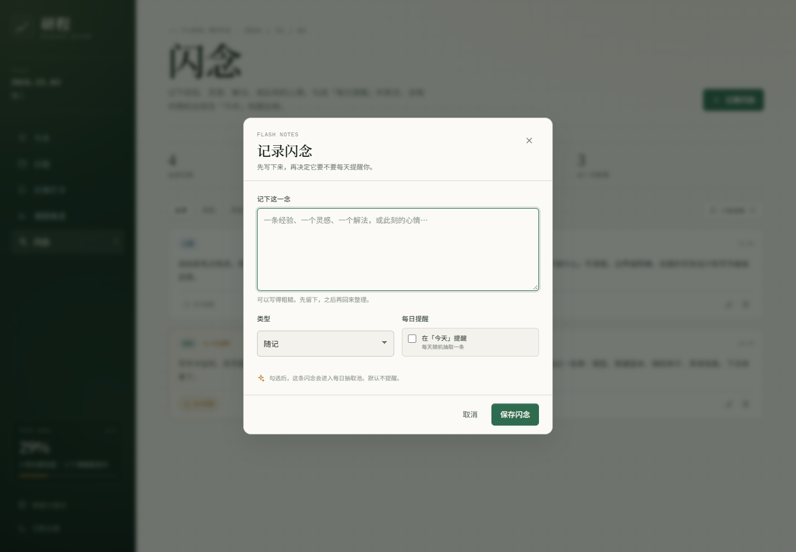 |

<p align="center">
  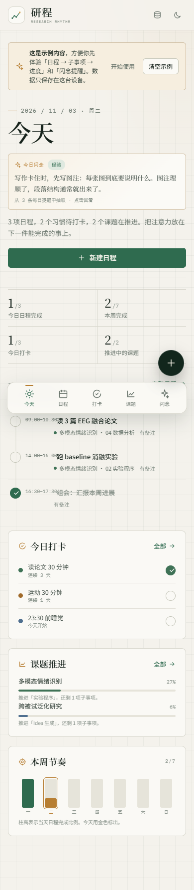
  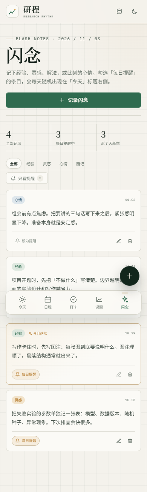
  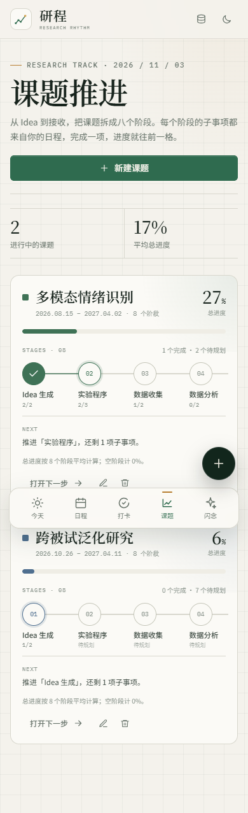
</p>

## 快速开始

### 直接打开

双击 `index.html` 即可使用。`file://` 下主题、日程、打卡、课题和闪念数据仍会保存在本地，但 PWA 安装与离线缓存不会启用。

### 本地服务器（推荐）

在项目根目录运行：

```bash
python -m http.server 8000
```

然后访问 <http://localhost:8000/>。首次打开会载入一份示例数据，方便体验「日程 → 子事项 → 进度」和「闪念提醒」；可在「数据与备份」中清空示例。

## 部署到 GitHub Pages

1. 在 GitHub 新建一个空仓库（例如 `yancheng`）。
2. 把本项目**根目录里的内容**上传到仓库根目录。至少需要：
   - `index.html`
   - `manifest.webmanifest`
   - `sw.js`
   - `icons/`
   - `.nojekyll`
3. 打开仓库 **Settings → Pages**：
   - Source 选择 **Deploy from a branch**
   - Branch 选择 `main`
   - Folder 选择 `/ (root)`
4. 等待 1–2 分钟，访问：

```text
https://<你的用户名>.github.io/<仓库名>/
```

> 不要把整个 `研程` 父文件夹再套一层上传；`index.html` 必须直接在 Pages 根目录下。

## 在电脑、手机和 iPad 上安装

推荐使用 **PWA 添加到主屏幕 / 桌面**，不需要应用商店，也不需要打包工具：

- **电脑 Chrome / Edge**：打开 Pages 地址，点击地址栏右侧的安装图标；也可以直接收藏。
- **Android Chrome**：打开 Pages 地址 → 右上角菜单 →「安装应用」或「添加到主屏幕」。
- **iPhone Safari**：打开 Pages 地址 → 分享 →「添加到主屏幕」。
- **iPad Safari**：打开 Pages 地址 → 分享 →「添加到主屏幕」。iPad 请用 Safari，不用 Chrome。

安装后会以独立窗口运行，有独立图标，并缓存应用外壳供离线打开。完整安装步骤见 [docs/INSTALL.md](docs/INSTALL.md)；可选的 APK 打包方式见 [docs/MOBILE_APP.md](docs/MOBILE_APP.md)。

## 跨设备同步（GitHub Gist）

同步是**可选**的；不开启时数据只在本机。开启后，本机数据会写入你自己的 Secret Gist。

| 未连接 | 已连接 |
|---|---|
| 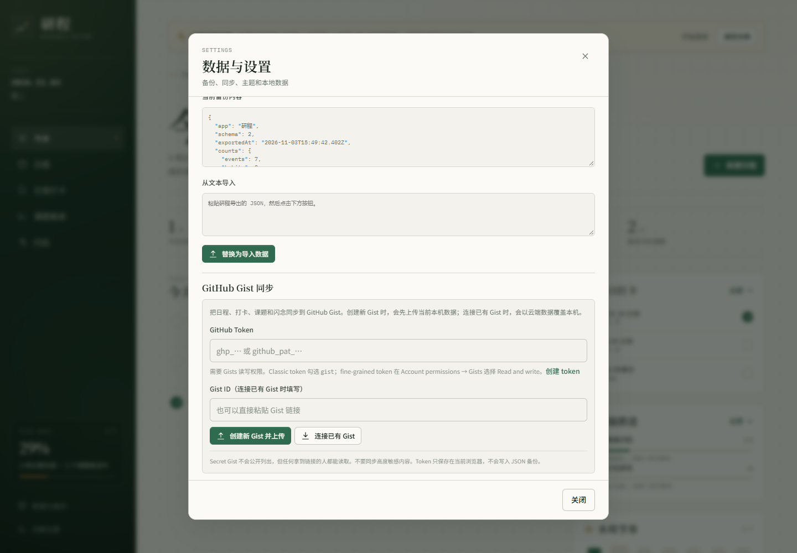 | 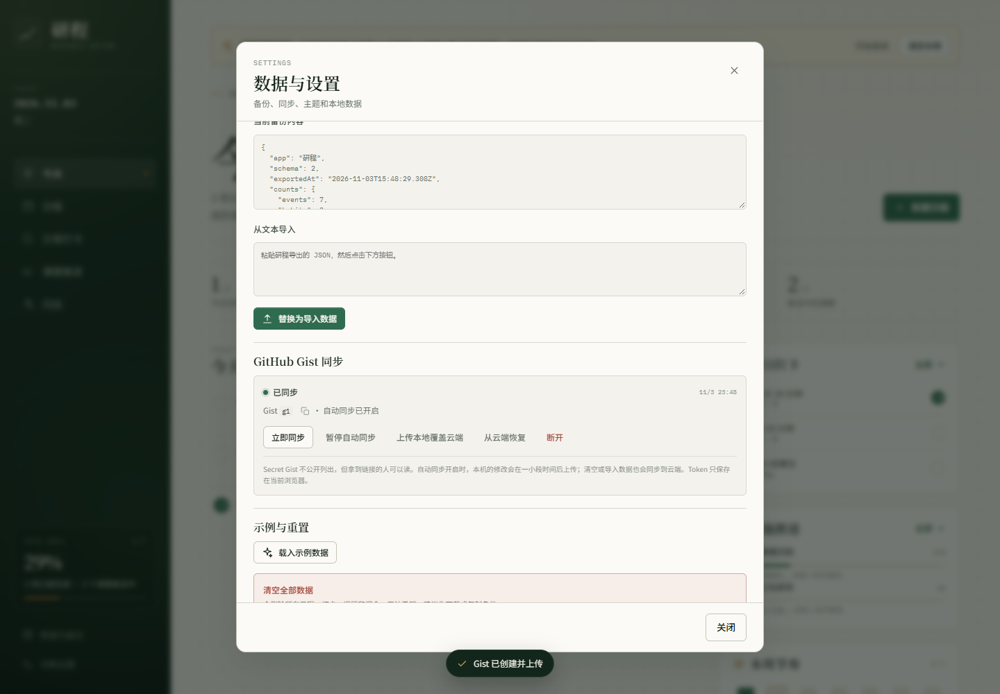 |

### 第一次设置

1. 在 GitHub 创建一个 token：
   - Classic token：Settings → Developer settings → Personal access tokens → Tokens (classic) → Generate new token，勾选 `gist`。
   - 或 fine-grained token：Account permissions → Gists → Read and write。
2. 在**第一台设备**打开「数据与备份」→「GitHub Gist 同步」。
3. 粘贴 token，点「创建新 Gist 并上传」。
4. 创建成功后，设置里会显示 Gist ID。复制它。
5. 在其他设备打开同一网址 →「数据与备份」→ 粘贴同一个 token 和 Gist ID →「连接已有 Gist」。
   - 连接会以云端数据覆盖该设备当前数据；如果该设备已有重要内容，先导出本地备份。

### 同步行为

- 本机修改后约 2 秒自动上传；应用打开时、回到前台时、联网时和每 2 分钟会检查云端。
- 如果云端和本机都修改过，会弹出选择：**保留本地** / **使用云端** / 稍后处理。
- 云端 Gist 是**Secret Gist**：不公开列出，但任何拿到链接的人都能读取。不要同步高度敏感内容。

<p align="center">
  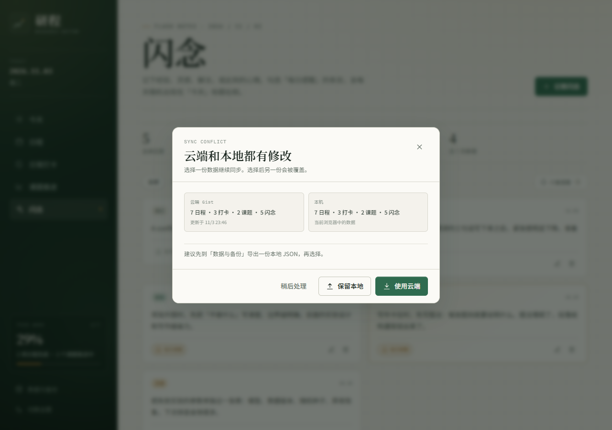
</p>
- token 只保存在当前浏览器的 localStorage 中，**不会写入 JSON 备份**。换设备时需要重新粘贴 token。
- 开启同步后，本机清空或导入数据也会同步到云端；操作前先导出备份。
- 如果 GitHub 无法访问，同步会失败，但本地数据不受影响；可继续使用手动 JSON。

## 升级与数据保留

**同一网址 + 同一浏览器 + 未清理站点数据**时，覆盖新版 `index.html` 不会清空旧数据。数据保存在 localStorage 的 `yancheng.state.v1`，新版会读取并迁移旧结构；新增字段会给旧记录补默认值。

会丢失本地数据的操作：

- 从本地预览（`preview.html` / `localhost`）切换到 GitHub Pages，或更换 GitHub 用户名、仓库名、自定义域名：这是不同的网址 origin，数据不会自动跟过去。
- 换浏览器、使用无痕模式、清理站点数据。
- 在另一台设备重新开始（除非通过 Gist 同步或 JSON 导入）。
- iPhone / iPad 的 Safari 标签页与主屏幕 App 可能使用不同的站点数据容器；请固定用主屏幕 App，或连接 Gist 同步。

建议：每次大版本更新前先「下载 JSON」备份；开启 Gist 同步后，云端是一份额外副本，但不能替代本地备份。未来升级不会在没有迁移的情况下更换存储 key。若更换网址，先在旧网址导出 JSON，再到新网址导入，或在两边连接同一个 Gist。

## 数据与备份

- 默认情况下，所有数据（日程、打卡、课题、闪念）只保存在当前浏览器。
- 开启 **GitHub Gist 同步**后，数据会写入你自己的 Secret Gist；关闭同步或未配置时不会上传。
- 没有开启同步时，手机、电脑和 iPad 是三份独立数据；换设备请用「复制 JSON / 下载 JSON」导出，再在另一台设备「从文本导入」。
- JSON 备份包含日程、打卡、课题和闪念，但**不包含** GitHub token 或同步设置；换设备后需要重新连接 Gist。
- 清理浏览器站点数据、换浏览器或使用无痕模式前，请先导出备份。
- 示例数据可在「数据与备份 → 清空全部数据」中删除。

## 项目结构

```text
.
├── index.html                 # 可直接部署的单文件应用（由 src 构建）
├── manifest.webmanifest       # PWA 清单
├── sw.js                      # 离线缓存 Service Worker
├── icons/                     # 180 / 192 / 512 / maskable 图标
├── docs/
│   ├── INSTALL.md             # 电脑 / 手机 / iPad 安装与同步步骤
│   ├── MOBILE_APP.md          # 手机安装与 APK 说明
│   └── screenshots/           # README 截图
├── src/                       # 可维护源码
│   ├── index.html
│   ├── styles/                # base / layout / components / overlays / today / schedule / habits / projects / settings / sparks / sync
│   └── js/                    # utils / state / seed / stats / ui / components / views / gist-sync / modals / settings / spark-actions / app
├── scripts/
│   ├── build.py               # 将 src 内联为根目录 index.html 和 preview.html
│   └── make_icons.py          # 重新生成 PWA 图标（需要 Pillow）
└── LICENSE
```

修改 `src/` 后运行：

```bash
python scripts/build.py
```

`index.html` 和 `preview.html` 会重新生成。`preview.html` 是给在线预览用的单文件版本，不参与 PWA。

## 已验证

- 月 / 周 / 日视图切换与日期翻页。
- 新建、编辑、删除、拖动日程；完成状态与课题子事项双向同步。
- 新建课题自动生成 8 个阶段；阶段日期、子事项和进度计算。
- 新建打卡、按天补记、颜色标记与连续天数。
- 闪念新建 / 编辑 / 删除、类型筛选、只看提醒；每日抽取同一天内保持稳定，刷新后不跳变。
- 提醒开关会即时更新「今天」的今日闪念卡片；旧示例数据会自动补齐示例闪念。
- 数据刷新后保留；JSON 导出 → 清空 → 导入完整恢复（含闪念）。
- GitHub Gist 同步：创建、自动推送、连接已有 Gist、跨设备拉取、冲突检测与「保留本地」覆盖，均通过模拟 GitHub API 测试。
- 同步设置、token 与 JSON 备份分离；断开同步不会删除云端 Gist。
- 1440px 与 390px 宽度无横向滚动；PWA manifest 返回 200，Service Worker 正常注册。
- 浅色 / 深色主题与系统主题跟随。
- 真实 GitHub 账号的首次 token 授权需要在部署后由你完成；测试用的是本地模拟 API，未使用真实 token。

## License

[MIT](LICENSE)
